# HỒ SƠ GATE REVIEW 1 — DUYỆT CODEBASE VÀ PHẠM VI (LAB 12)
## Đề tài: Hệ thống Bầu cử Kín 2 pha (Commit - Reveal) kết hợp Quorum
### Học phần: ECO2432 — Web3 Starter

- **Nhóm thực hiện:**
  - **Nguyễn Thị Kim Chi** (Mã SV: 23K4300025) — Smart Contract Dev / Tester
  - **Võ Thị Thư** (Mã SV: 23K4300038) — Frontend Dev / Tester
- **Hợp đồng cốt lõi:** [`contracts/project/ProjectCore.sol`](../contracts/project/ProjectCore.sol)
- **Địa chỉ hợp đồng trên Sepolia:** [`0x7D3bC21A8532d2011cF970C0701413C236C53Ddd`](https://sepolia.etherscan.io/address/0x7D3bC21A8532d2011cF970C0701413C236C53Ddd)

---

## MỤC 1: Tự kiểm tra sức khỏe Repo (Checklist 5/5 ĐẠT)

| STT | Tiêu chí đánh giá sức khỏe Repo | Kết quả | Chi tiết đối soát và bằng chứng |
| :---: | :--- | :---: | :--- |
| **1** | `README.md` mô tả rõ bài toán, người dùng, kiến trúc Commit - Reveal và hướng dẫn chạy | **ĐẠT** `[x]` | File [`README.md`](../README.md) nêu bật bài toán loại bỏ áp lực tâm lý đám đông trong bầu cử CLB, đối tượng sinh viên, cơ chế 4 pha và địa chỉ triển khai Sepolia. |
| **2** | `docs/PROJECT_PLAN.md`, `docs/SPEC.md`, `docs/ECONOMIC_RULES.md` đồng bộ 100% với mã nguồn `ProjectCore.sol` | **ĐẠT** `[x]` | Toàn bộ tài liệu đồng bộ chuẩn xác với hợp đồng (125 dòng mã, 4 pha `Registration`, `Commit`, `Reveal`, `Ended`, và 5 quy tắc nghiệp vụ R1–R5). |
| **3** | `ProjectCore.sol` biên dịch chuẩn Solidity `^0.8.20` và đã triển khai thực tế lên mạng Sepolia | **ĐẠT** `[x]` | Hợp đồng biên dịch thành công không cảnh báo trên Remix IDE, triển khai thực tế tại địa chỉ: `0x7D3bC21A8532d2011cF970C0701413C236C53Ddd`. |
| **4** | Đã có bằng chứng thực nghiệm on-chain gồm 1 ca hợp lệ và 1 ca vi phạm bị chặn trong `evidence/lab-11/` | **ĐẠT** `[x]` | Báo cáo [`evidence/lab-11/README.md`](../evidence/lab-11/README.md) ghi nhận ca 1 hợp lệ (Block `11899220`, TxHash `0x6e37bcfff00cfbdcb16214a7a063fdfdcc9a0666f17a6f38fdacc4183a9942ef`) và ca 2 gian lận bị revert (Block `11899237`, TxHash `0xd43e0c6c27ce4ffa07724dc0c6b0e5aed4eda3bdab40ddd2635f27d23bdb6853`). |
| **5** | Lịch sử commit trên nhánh `main` ghi nhận đóng góp đầy đủ, cân bằng của cả hai thành viên | **ĐẠT** `[x]` | Lịch sử Git ghi nhận đóng góp của Nguyễn Thị Kim Chi (`kimchi000-hash`) và Võ Thị Thư (`23k4300038`), thể hiện qua các mốc nghiệm thu Lab 8, 9, 10, 11 và 12. |

---

## MỤC 2: Kịch bản Thuyết trình Demo 3 phút tại Gate Review 1

Khung thời gian thuyết minh trước Giảng viên và Hội đồng thẩm định:

```mermaid
gantt
    title Kịch bản Thuyết trình Gate Review 1 (Tổng thời lượng: 180 giây)
    dateFormat  s
    axisFormat %S s
    section Nội dung trình bày
    1. Vấn đề thực tế & Nỗi đau người dùng   :active, sec1, 0, 30s
    2. Quy tắc kinh tế cốt lõi (Commit-Reveal) :sec2, after sec1, 30s
    3. Demo mã nguồn & Giao dịch Sepolia hợp lệ :sec3, after sec2, 60s
    4. Demo chặn gian lận on-chain (Negative test) :sec4, after sec3, 30s
    5. Kế hoạch hoàn thiện Lab 13 - Lab 15     :sec5, after sec4, 30s
```

### 1. 0:00 – 0:30 (30 giây): Bài toán thực tế & Nỗi đau người dùng
- *Nội dung:* "Chào Thầy và các bạn, nhóm chúng em giải quyết bài toán bầu cử Ban cán sự CLB/Lớp. Bầu cử truyền thống dễ bị gian lận và kiểm phiếu thủ công sai lệch. Nhưng nếu bầu on-chain theo cách thông thường, số phiếu công khai tức thời sẽ gây ra hiệu ứng tâm lý đám đông (Bandwagon Effect), khiến sinh viên bầu sau bị định hướng hoặc chịu áp lực xã hội. Nhóm chúng em nâng cấp giải pháp lên **Bầu cử kín 2 pha Commit - Reveal**."

### 2. 0:30 – 1:00 (30 giây): Quy tắc kinh tế cốt lõi (Economic Rules)
- *Nội dung:* "Hệ thống vận hành theo 2 quy tắc kinh tế trọng tâm:
  1. **Commitment mã hóa:** Cử tri nộp mã băm $\text{keccak256}(\text{candidateId}, \text{salt}, \text{msg.sender})$ trong pha Commit. Nhờ nhúng địa chỉ ví `msg.sender`, không ai có thể giải mã lá phiếu hoặc sao chép mã băm của người khác trong mempool (Anti Copy-Voting).
  2. **Ràng buộc Quorum bằng Basis Points:** Kết quả chỉ hợp lệ khi tỷ lệ cử tri mở phiếu đạt tối thiểu $\text{quorumBps} = 5,000$ (tương đương 50.00% theo chuẩn quy ước $1\% = 100 \text{ bps}$)."

### 3. 1:00 – 2:00 (60 giây): Trình diễn Mã nguồn & Bằng chứng Sepolia hợp lệ
- *Nội dung:* "Hợp đồng [`ProjectCore.sol`](../contracts/project/ProjectCore.sol) được thiết kế tinh gọn 125 dòng mã với máy trạng thái 4 pha. Chúng em đã deploy thực tế lên Sepolia tại địa chỉ `0x7D3bC21A8532d2011cF970C0701413C236C53Ddd`.
  - Đây là giao dịch bỏ phiếu hợp lệ tại Block `11899220`, TxHash `0x6e37bcfff00cfbdcb16214a7a063fdfdcc9a0666f17a6f38fdacc4183a9942ef`.
  - Trạng thái `Success (Status: 1)`, hợp đồng phát sự kiện `Committed`, lá phiếu được bảo mật vĩnh viễn trên blockchain."

### 4. 2:00 – 2:30 (30 giây): Trình diễn Chặn gian lận on-chain (Negative Test)
- *Nội dung:* "Để chứng minh tính bảo mật của mô hình Checks-Effects-Interactions:
  - Đây là giao dịch khi cử tri cố tình nộp cam kết lần thứ 2 tại Block `11899237`, TxHash `0xd43e0c6c27ce4ffa07724dc0c6b0e5aed4eda3bdab40ddd2635f27d23bdb6853`.
  - Giao dịch bị mạng lưới đào và từ chối với trạng thái `Fail / Reverted (Status: 0)` bởi lỗi tùy biến `AlreadyCommitted()`. Hệ thống loại bỏ hoàn toàn hành vi thay đổi phiếu hoặc gian lận nộp lặp."

### 5. 2:30 – 3:00 (30 giây): Kế hoạch hoàn thiện Lab 13 – Lab 15
- *Nội dung:* "Trong giai đoạn tiếp theo:
  - **Lab 13:** Kiểm thử chuyên sâu 7 ca tấn công dòng điều khiển và hardening mã nguồn.
  - **Lab 14:** Tiến hành rà soát chéo (Cross-audit) hợp đồng với nhóm bạn.
  - **Lab 15:** Hoàn thiện giao diện Web DApp tự động tính mã băm bằng ethers.js v6 kết nối MetaMask và phát hành trên GitHub Pages."

---

## MỤC 3: Quyết định Duyệt Phạm vi & Khóa Phạm vi (Scope Lock)

### 3.1 Kết luận Đề xuất
- **Đánh giá thẩm định:** **QUA (APPROVED)**.
- **Phân loại đề tài:** **Đề tài Nâng cao**. Hợp đồng đã vượt yêu cầu cơ bản của học phần khi tích hợp thành công cơ chế Mật mã học Bầu cử kín Commit - Reveal và kiểm soát Quorum bằng Basis Points.

### 3.2 Các tính năng chủ động cắt bỏ (Out-of-scope / Scope Trim)
Để đảm bảo sản phẩm hoạt động ổn định, tin cậy và không bị phân tán nguồn lực, nhóm quyết định **khóa phạm vi** và cắt bỏ các tính năng sau:
1. **Không phát hành Token ERC-20 đầu cơ:** Giữ mô hình Zero-speculation, chỉ định danh quyền cử tri qua mapping `isVoter` để tập trung vào tính công bằng.
2. **Không thiết kế bầu cử đa vòng phức tạp:** Giữ chu trình 1 vòng duy nhất với 4 pha rõ ràng (`Registration` $\rightarrow$ `Commit` $\rightarrow$ `Reveal` $\rightarrow$ `Ended`).
3. **Giữ kích thước hợp đồng tinh gọn:** Khống chế mã nguồn dưới 150 dòng (hiện tại 125 dòng), tuân thủ nghiêm ngặt chuẩn Checks-Effects-Interactions (CEI) và Custom Errors.

### 3.3 Ba nhiệm vụ bắt buộc hoàn thành giai đoạn Lab 13 – 15

| STT | Nhiệm vụ bắt buộc | Người phụ trách chính | Hạn hoàn thành | Sản phẩm bàn giao |
| :---: | :--- | :---: | :---: | :--- |
| **1** | **Lab 13:** Thiết kế bộ Test Suite kiểm thử 7 kịch bản tấn công gian lận và tối ưu an ninh hợp đồng | **Nguyễn Thị Kim Chi** | Trước buổi Lab 13 | [`evidence/lab-13/`](../evidence/lab-13/), Test suite Remix/Hardhat |
| **2** | **Lab 14:** Tổ chức rà soát chéo (Cross-audit) với nhóm bạn, lập ma trận lỗi và phương án khắc phục | **Nguyễn Thị Kim Chi** & **Võ Thị Thư** | Trước buổi Lab 14 | [`docs/CROSS_AUDIT.md`](../docs/CROSS_AUDIT.md), Báo cáo phản biện chéo |
| **3** | **Lab 15:** Xây dựng Giao diện Web DApp tự động băm `commitment` với `ethers.js v6` và deploy GitHub Pages | **Võ Thị Thư** | Trước buổi Lab 15 | [`web/`](../web/), DApp URL trên GitHub Pages |
