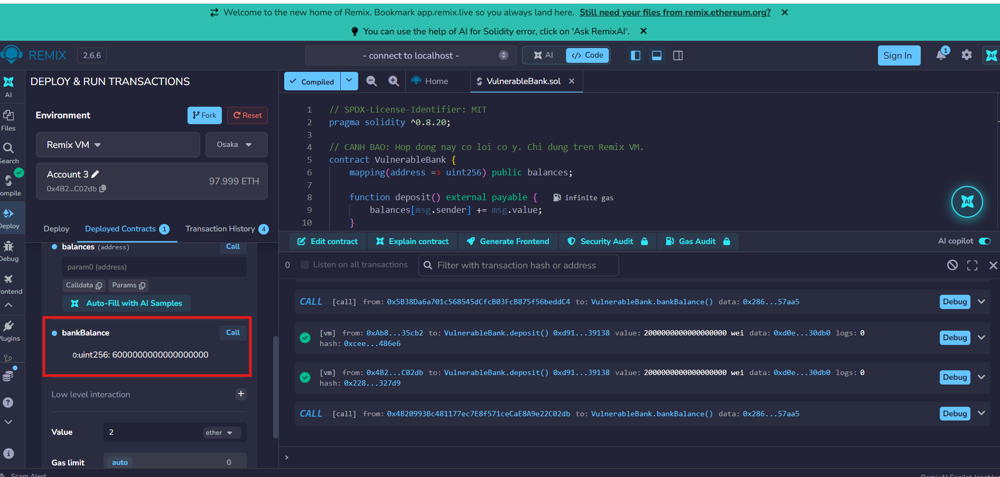
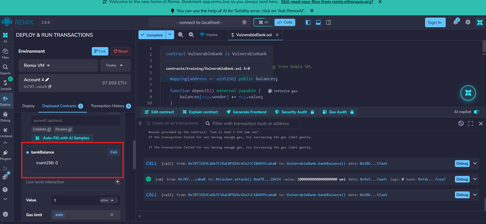
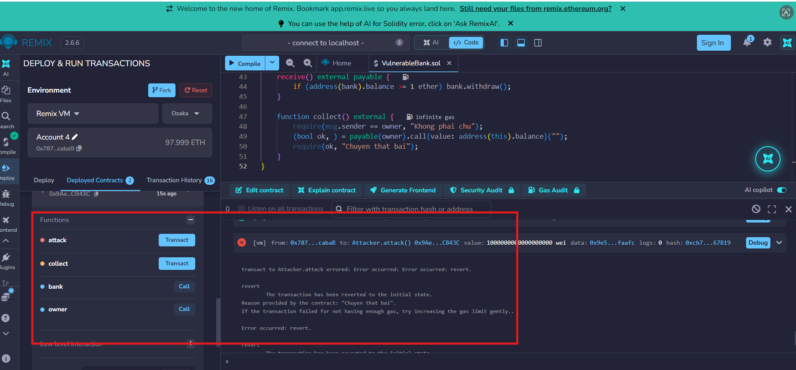
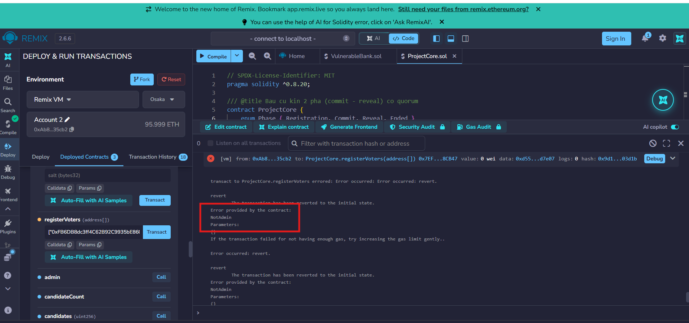

# BÁO CÁO THẨM ĐỊNH BẢO MẬT & KIỂM THỬ DÒNG ĐIỀU KHIỂN (LAB 13)
## Chủ đề: Phân tích Lỗ hổng Reentrancy & Kiểm thử Phân quyền (Negative Test)
### Học phần: ECO2432 — Web3 Starter

- **Hợp đồng kiểm nghiệm 1 (Training):** [`contracts/training/VulnerableBank.sol`](../../contracts/training/VulnerableBank.sol) (chứa lỗi Reentrancy) & [`contracts/training/VulnerableBankFixed.sol`](../../contracts/training/VulnerableBankFixed.sol) (bản vá CEI)
- **Hợp đồng kiểm nghiệm 2 (Project):** [`contracts/project/ProjectCore.sol`](../../contracts/project/ProjectCore.sol)
- **Kịch bản kiểm thử tự động:** [`test/ProjectCore.test.js`](../../test/ProjectCore.test.js)
- **Thành viên thực hiện:**
  - Nguyễn Thị Kim Chi (23K4300025) — Security Tester / Auditor
  - Võ Thị Thư (23K4300038) — Tester / Frontend

---

## 1. Phân tích Cơ chế Lỗ hổng Reentrancy (Tái nhập)

### 1.1 Nguyên nhân gốc rễ (Root Cause)
Lỗ hổng **Reentrancy** trong hợp đồng `VulnerableBank` xuất hiện do sự vi phạm trật tự xử lý luồng giao dịch:
- Khi người dùng gọi hàm `withdraw()`, hợp đồng thực hiện chuyển tiền bằng lệnh cấp thấp:
  ```solidity
  (bool ok, ) = msg.sender.call{value: balance}("");
  ```
- Lệnh gọi này được thực thi **TRƯỚC KHI** cập nhật trạng thái số dư nội bộ `balances[msg.sender] = 0;`.
- Khi quyền điều khiển dòng lệnh được chuyển giao sang địa chỉ nhận tiền (`msg.sender` — vốn là một Smart Contract tấn công), hàm `receive() external payable` của kẻ tấn công được tự động kích hoạt.

### 1.2 Kịch bản khai thác lặp (Attack Flow)
1. **Nạp vốn:** Kẻ tấn công gọi `attack()` nạp `1 ETH` vào `VulnerableBank` để hợp thức hóa số dư `balances[Attacker] = 1 ETH`.
2. **Kích hoạt rút tiền:** Kẻ tấn công gọi `bank.withdraw()`.
3. **Chuyển giao quyền điều khiển:** Ngân hàng kiểm tra `balance > 0` (hợp lệ) và gửi `1 ETH` sang hợp đồng `Attacker`.
4. **Tái nhập (Reentrancy Loop):** Hàm `receive()` của `Attacker` nhận được ETH, ngay lập tức kiểm tra `if (address(bank).balance >= 1 ether)` và gọi ngược lại `bank.withdraw()`.
5. **Rút cạn quỹ:** Vì ở lần gọi thứ nhất, dòng lệnh cập nhật `balances[msg.sender] = 0` chưa hề được chạy đến, ngân hàng vẫn ghi nhận số dư của `Attacker` là `1 ETH`. Quá trình rút tiền tiếp tục lặp lại đệ quy cho đến khi ngân hàng bị rút cạn toàn bộ số dư ETH.

---

## 2. Các Phương án Khắc phục & So sánh Ưu - Nhược điểm

| Tiêu chí so sánh | Cách 1: Checks-Effects-Interactions (CEI) | Cách 2: OpenZeppelin `ReentrancyGuard` |
| :--- | :--- | :--- |
| **Cơ chế hoạt động** | Cập nhật trạng thái số dư nội bộ (`balances = 0`) **TRƯỚC** khi gọi lệnh chuyển ETH (`msg.sender.call`). | Sử dụng modifier `nonReentrant` với biến cờ khóa `_status` (1 = Not Entered, 2 = Entered) để chặn đệ quy. |
| **Tiêu hao Gas** | **Tối ưu nhất:** Không tốn thêm chi phí lưu trữ hay đọc/ghi biến cờ trạng thái mới. | **Tốn thêm Gas:** Mất chi phí cho 2 thao tác ghi bộ nhớ `SSTORE` (khóa và mở khóa trạng thái). |
| **Độ phụ thuộc** | **Độc lập:** Viết trực tiếp trong mã nguồn, không phụ thuộc vào thư viện ngoài. | **Phụ thuộc:** Cần cài đặt và kế thừa thư viện `@openzeppelin/contracts`. |
| **Khả năng bảo vệ** | Tuyệt đối an toàn cho các luồng rút tiền đơn lẻ và logic cục bộ. | An toàn toàn diện cho cả các mô hình phức tạp (Cross-contract/Cross-function reentrancy). |
| **Yêu cầu kỹ thuật** | Đòi hỏi lập trình viên phải luôn giữ kỷ luật viết mã nghiêm ngặt. | Đơn giản, dễ chuẩn hóa trong toàn dự án bằng cách gắn modifier. |

---

## 3. Bản chất Triệt tiêu Lỗ hổng của Checks-Effects-Interactions (3 Câu chốt)

1. Theo **nguyên tắc Checks-Effects-Interactions**, việc đưa lệnh `balances[msg.sender] = 0` lên trước giúp trạng thái số dư của cử tri/người gửi được xóa sạch về 0 ngay lập tức trong bộ nhớ lưu trữ trước khi chuyển giao quyền điều khiển.
2. Khi kẻ tấn công kích hoạt hàm `receive()` để gọi lại `withdraw()`, bước kiểm tra điều kiện `require(balances[msg.sender] > 0)` sẽ lập tức phát hiện số dư bằng 0 và hoàn tác giao dịch.
3. Nhờ áp dụng **nguyên tắc Checks-Effects-Interactions**, chu kỳ gọi đệ quy bị bẻ gãy hoàn toàn ngay ở lần tái nhập đầu tiên, bảo vệ an toàn tuyệt đối cho quỹ tiền của hợp đồng.

---

## 4. Mã nguồn Bản vá Hoàn chỉnh: [`contracts/training/VulnerableBankFixed.sol`](../../contracts/training/VulnerableBankFixed.sol)

Toàn bộ hợp đồng đã được tạo hoàn chỉnh tại thư mục đào tạo [`contracts/training/VulnerableBankFixed.sol`](../../contracts/training/VulnerableBankFixed.sol), áp dụng triệt để nguyên tắc **Checks-Effects-Interactions (CEI)** và phát sự kiện `Withdraw` theo chuẩn `AGENTS.md`:

```solidity
function withdraw() external {
    // 1. CHECKS: Kiểm tra điều kiện đầu vào
    uint256 balance = balances[msg.sender];
    require(balance > 0, "Khong co so du");
    
    // 2. EFFECTS: Cập nhật trạng thái sổ sách nội bộ TRƯỚC TIÊN
    balances[msg.sender] = 0;
    
    // 3. INTERACTIONS: Chuyển tiền thật ra bên ngoài SAU CÙNG
    (bool ok, ) = msg.sender.call{value: balance}("");
    require(ok, "Chuyen that bai");

    emit Withdraw(msg.sender, balance);
}
```

---

## 5. Kịch bản Kiểm thử Thất bại (Negative Test) trên `ProjectCore.sol`

Mã nguồn kiểm thử tự động tại [`test/ProjectCore.test.js`](../../test/ProjectCore.test.js), xác thực việc hợp đồng hoàn tác chính xác mã lỗi tùy biến `NotAdmin()` khi tài khoản lạ cố tình cấp quyền cử tri:

```javascript
const { expect } = require("chai");
const { ethers } = require("hardhat");

describe("ProjectCore - Negative Tests (Lab 13)", function () {
    it("Should revert if a non-admin tries to register voters", async function () {
        const [admin, hacker, user] = await ethers.getSigners();

        // 1. Triển khai hợp đồng với các tham số khởi tạo
        const ProjectCore = await ethers.getContractFactory("ProjectCore");
        const candidates = ["Alice", "Bob"];
        const projectCore = await ProjectCore.deploy(
            candidates, 
            10, // regMinutes
            10, // commitMinutes
            10, // revealMinutes
            5000 // quorumBps
        );

        // 2. Kẻ tấn công (hacker) cố tình gọi hàm đăng ký cử tri
        // Sử dụng expect().to.be.revertedWithCustomError để bắt chính xác lỗi NotAdmin()
        await expect(
            projectCore.connect(hacker).registerVoters([user.address])
        ).to.be.revertedWithCustomError(projectCore, "NotAdmin");
    });
});
```

---

## 6. Danh mục Hình ảnh Minh chứng Thực nghiệm Remix VM

*(Các hình ảnh minh chứng được đính kèm theo đúng trình tự thẩm định):*

### 1. Số dư ban đầu của Bank (6 ETH)
Ngân hàng nắm giữ 6 ETH do các cử tri/người dùng hợp lệ gửi vào trước khi bị tấn công:


### 2. Số dư Bank bị rút cạn về 0 ETH (Khi chưa vá lỗi)
Kẻ tấn công khai thác vòng lặp `receive()` rút sạch 6 ETH chỉ với 1 ETH vốn ban đầu:


### 3. Giao dịch tấn công bị Revert sau khi vá lỗi Checks-Effects-Interactions
Sau khi đưa lệnh `balances[msg.sender] = 0` lên trước lệnh `call`, giao dịch tấn công bị chặn đứng:


### 4. Lỗi NotAdmin() trên hợp đồng ProjectCore
Ví lạ cố tình gọi hàm `registerVoters` bị từ chối ngay lập tức với mã lỗi tùy biến `NotAdmin()`:

